<div align="center">


# TestPilot AI

**Turn user stories into test cases in seconds.**

Paste a user story, click **Generate**, and Claude writes structured positive, negative and edge test
cases — then turns them into a ready-to-run Playwright script or a formatted Excel sheet.

[](https://github.com/SheetalK01/testpilot-ai/actions/workflows/ci.yml)


[](LICENSE)
<br />


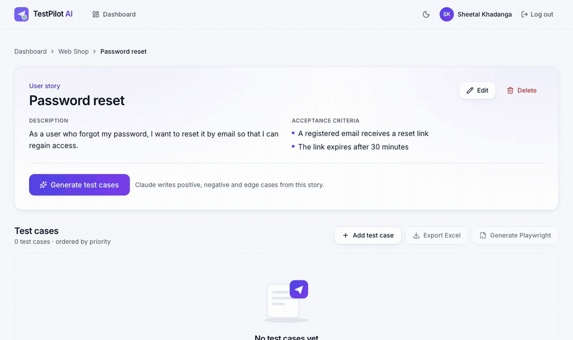

</div>

## Why I built this

I'm a QA engineer. A big part of my week is reading user stories and turning acceptance criteria into
test cases — the same happy path, the same "required field missing", the same boundary checks, typed
out again and again. TestPilot AI does that first draft in seconds so I can spend my time on what a
tool can't do: thinking about risk, exploring, and automating.

It is also my portfolio project, built the way I would want a production system to be built: a
layered and secured API, a validated AI integration, an accessible UI, and **tests at every layer**
(unit, integration, API, E2E, security, accessibility, visual and performance) running in CI.

## Features

- **AI test generation** — Claude reads the story and its acceptance criteria and returns 3–15
  schema-validated test cases (type, priority, preconditions, steps, expected result).
- **Keeps your work** — regenerating replaces only AI-written cases; manual cases are never touched.
- **Edit, add, delete and filter** test cases (positive / negative / edge), with expandable steps.
- **Playwright export** — one `test()` per case with role- and label-based locators, syntax
  highlighted, one click to copy.
- **Excel export** — formatted `.xlsx` with numbered steps, colour-coded types, frozen header and filters.
- **Dashboard** — totals, charts by type and priority, and a log of every AI run (model, status, duration).
- **Polished UI** — light and dark mode, responsive down to 375 px, keyboard accessible, WCAG 2.1 AA.
- **Mock AI mode** — free, deterministic AI for local development, tests and CI.

## Screenshots

| Light | Dark |
|---|---|
| 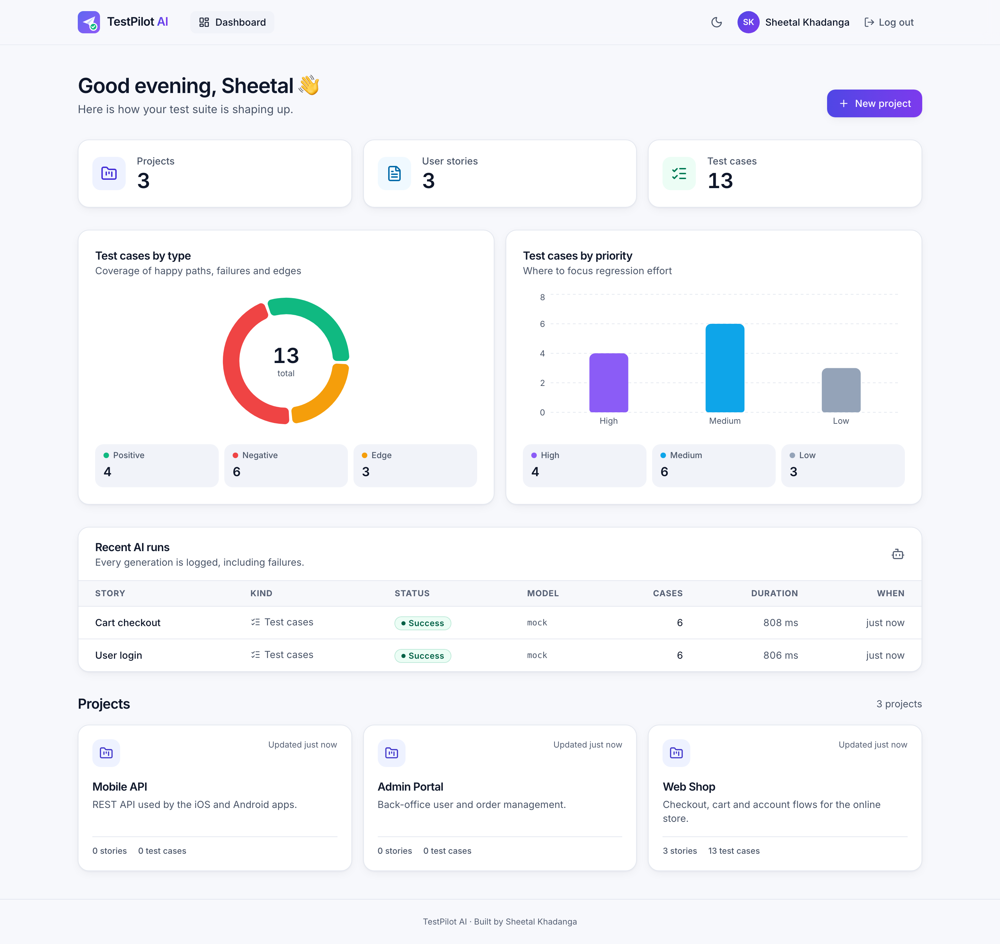 | 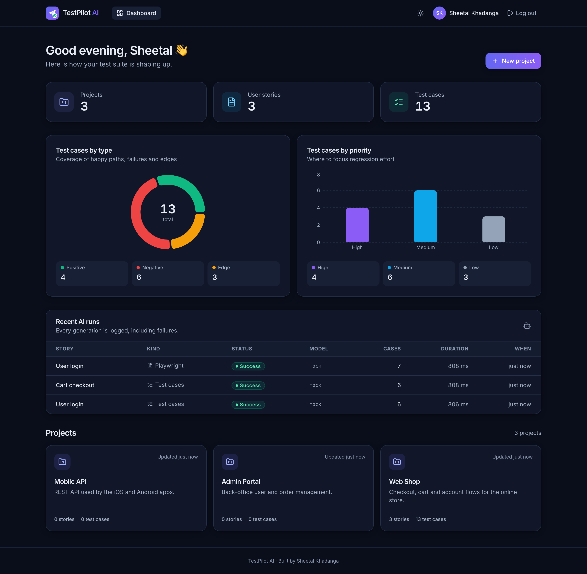 |
| 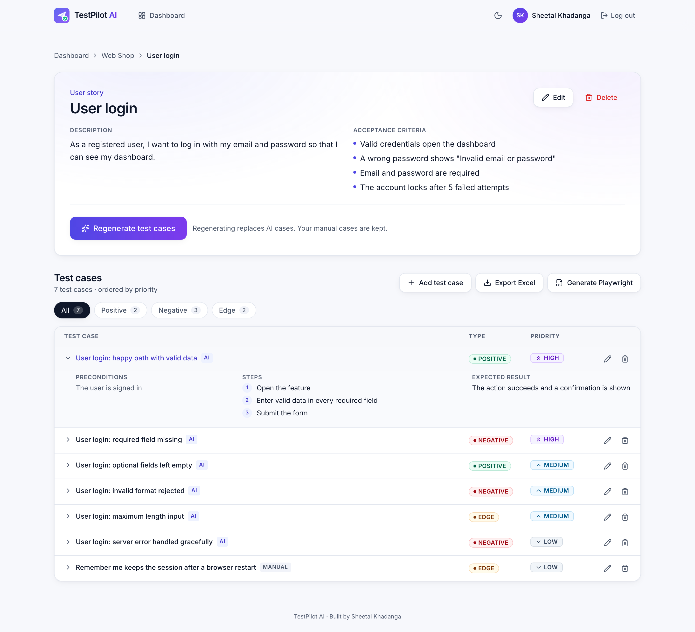 | 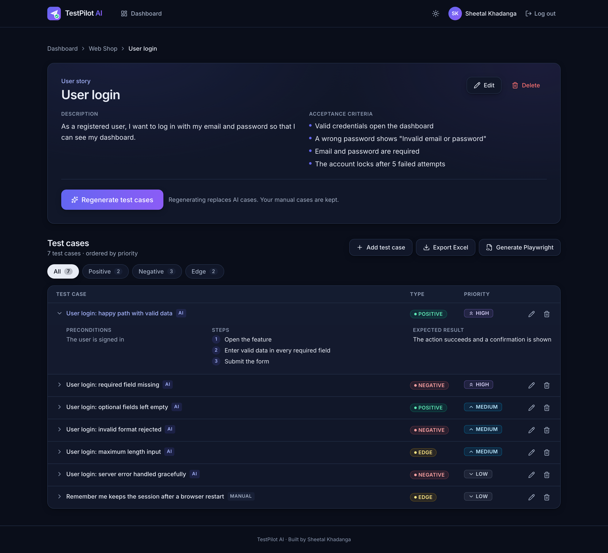 |
| 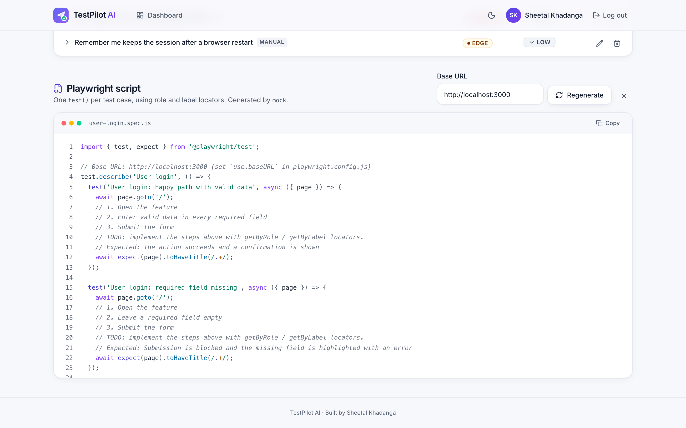 | 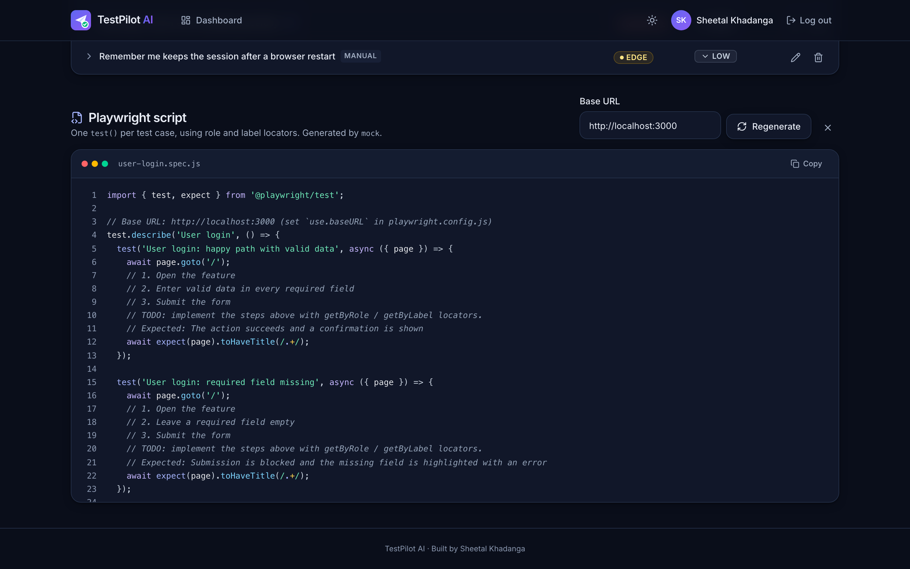 |
| 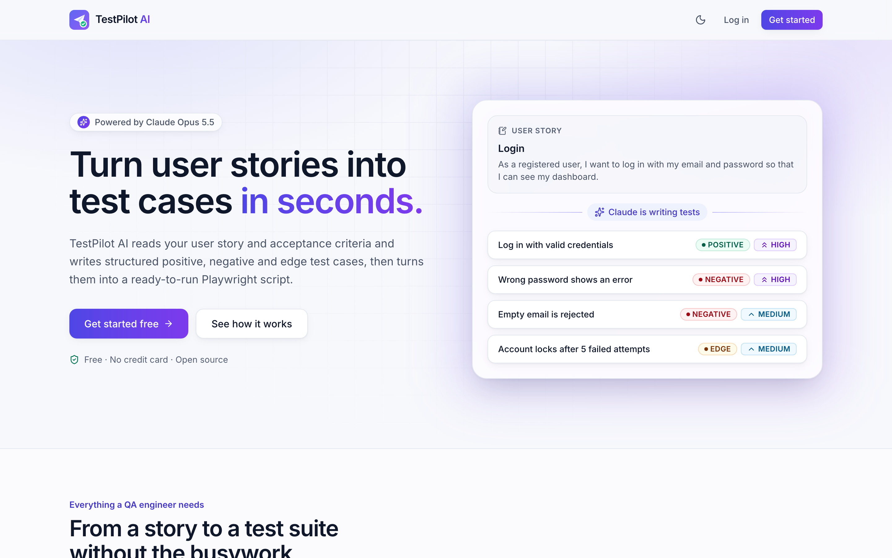 | 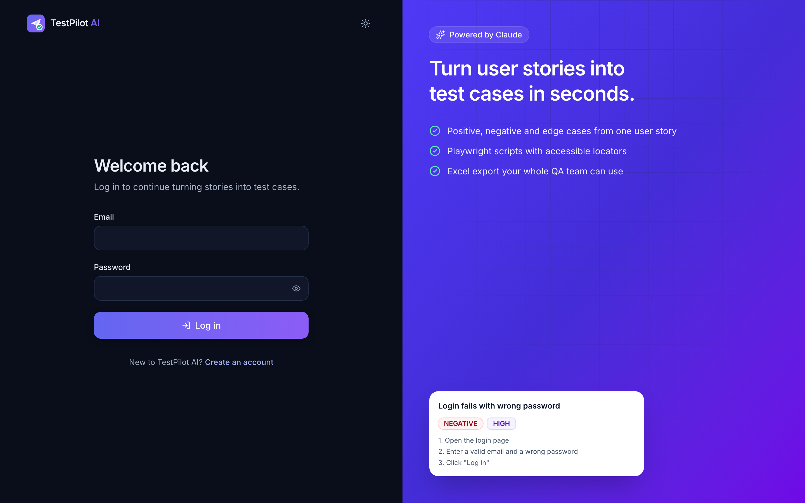 |

<p align="center">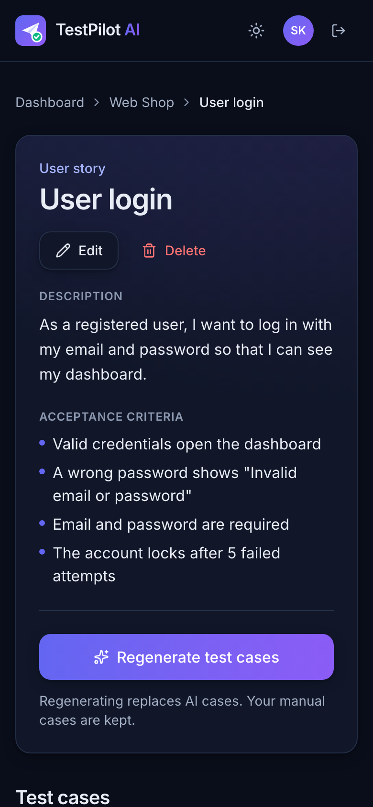</p>

Screenshots are produced by [`scripts/capture-screenshots.js`](scripts/capture-screenshots.js) with Playwright.

## Architecture

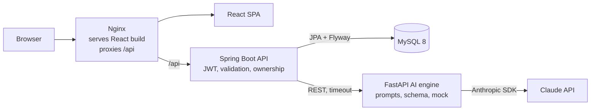

- The browser never talks to the AI engine. The backend checks the JWT and resource ownership first.
- The AI engine is **stateless** and is the only place the Anthropic API key lives.
- Every request carries an **`X-Request-Id`** that appears in Nginx, backend and AI engine logs.

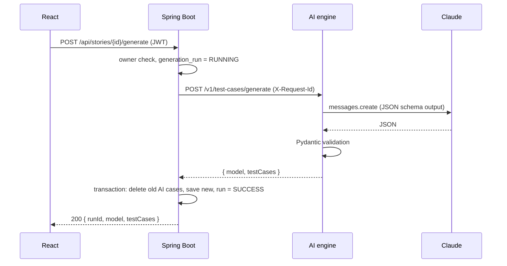

The design decisions behind this (and their trade-offs) are in
[`docs/INTERVIEW_NOTES.md`](docs/INTERVIEW_NOTES.md).

## Tech stack

| Layer | Technology |
|---|---|
| Frontend | React 18, Vite, React Router 6, Tailwind CSS v4, Recharts, lucide-react, prism-react-renderer, Inter |
| Backend | Java 17, Spring Boot 4.1 (Web MVC, Data JPA, Security + OAuth2 Resource Server, Validation, Actuator), springdoc-openapi, Apache POI |
| Database | MySQL 8.4 (Docker), H2 in MySQL mode (local + tests), Flyway migrations |
| AI engine | Python 3.12, FastAPI, Pydantic v2, official `anthropic` SDK, Claude Opus 5.5 (`claude-opus-5-5`) |
| QA | Playwright + `@axe-core/playwright`, JUnit 5 + MockMvc + Mockito, pytest, k6, JaCoCo |
| DevOps | Docker (multi-stage, non-root), Docker Compose, Nginx, GitHub Actions |
| Code quality | ESLint (incl. jsx-a11y, react-hooks) + Prettier, Ruff, JaCoCo coverage gate |

## Quick start

**Prerequisites:** Docker *or* Java 17, Node 20.19+, Python 3.12.

```bash
git clone git@github.com:SheetalK01/testpilot-ai.git
cd testpilot-ai
cp .env.example .env        # AI_MODE=mock by default: no API key needed
```

### Option A — Docker (closest to production)

```bash
docker compose up --build
```

| URL | What |
|---|---|
| http://localhost:3000 | The app |
| http://localhost:8080/swagger-ui.html | API docs (Swagger UI) |

### Option B — without Docker

```bash
./scripts/dev-local.sh
```

Starts the backend (in-memory H2), the AI engine and the Vite dev server, installing dependencies on
the first run. Open **http://localhost:5173**. `Ctrl+C` stops everything.

### Use the real Claude model

Put your key in `.env` (never commit it) and switch the mode:

```bash
AI_MODE=live
ANTHROPIC_API_KEY=sk-ant-...
```

Then restart (`docker compose up -d --build ai-engine`, or re-run `dev-local.sh`). If `AI_MODE=live`
is set without a key, the AI engine logs a warning and falls back to mock mode.

## Environment variables

| Variable | Used by | Default |
|---|---|---|
| `AI_MODE` | AI engine | `mock` (`live` calls Claude) |
| `ANTHROPIC_API_KEY` | AI engine | — (required for `live`) |
| `ANTHROPIC_MODEL` | AI engine | `claude-opus-5-5` |
| `LLM_TIMEOUT_SECONDS` | AI engine | `90` |
| `DB_URL`, `DB_USERNAME`, `DB_PASSWORD` | backend | H2 in-memory; Compose uses `jdbc:mysql://mysql:3306/testpilot` |
| `JWT_SECRET` | backend | dev-only default; set ≥ 32 random characters (`openssl rand -base64 48`) |
| `JWT_TTL_MINUTES` | backend | `720` |
| `AI_ENGINE_URL`, `AI_ENGINE_TIMEOUT_SECONDS` | backend | `http://localhost:8000`, `120` |
| `CORS_ALLOWED_ORIGINS` | backend | `http://localhost:5173,http://localhost:4173,http://localhost:3000` |
| `VITE_API_URL` | frontend | empty (same origin) |
| `MYSQL_ROOT_PASSWORD`, `MYSQL_DATABASE`, `MYSQL_USER`, `MYSQL_PASSWORD` | Compose | placeholders in `.env.example` |

## Testing

**261 automated tests** across every layer, all running in CI against the mock AI.

| Suite | Tool | Tests | Command |
|---|---|---|---|
| Backend unit + integration | JUnit 5, MockMvc, Mockito, H2 | 92 | `cd testpilot_backend && ./mvnw verify` |
| AI engine | pytest (Anthropic client mocked) | 51 | `cd ai_engine && .venv/bin/pytest --cov` |
| E2E UI journeys | Playwright (POM + fixtures) | 27 | `cd e2e && npx playwright test --project=ui` |
| API contracts, boundaries, security | Playwright request | 73 | `npx playwright test --project=api` |
| Accessibility (light + dark) | axe-core | 14 | `npx playwright test --project=a11y` |
| Visual regression | Playwright screenshots | 4 | `npx playwright test --project=visual` |
| Performance smoke | k6 (10 VUs × 30 s, p95 < 500 ms) | 1 scenario | `k6 run perf/smoke.js` |

```bash
cd e2e && npm ci && npx playwright install chromium
npx playwright test                 # all projects; starts AI engine, backend and frontend if needed
npx playwright test --grep @smoke   # tags: @smoke @regression @api @security @a11y @visual
npx playwright show-report
```

CI also runs the API and security suites against the real Docker stack (MySQL 8.4 behind Nginx),
which is how a MySQL-only deadlock under concurrent generations was found and fixed.

Coverage: the backend's JaCoCo report is at `testpilot_backend/target/site/jacoco/index.html`; the
build fails if service classes drop below 80 % line coverage (currently ~99 %, 96.8 % overall).

The QA approach — pyramid, risks, entry/exit criteria and the full test case table — is in
[`docs/TEST_PLAN.md`](docs/TEST_PLAN.md).

## AI quality evaluation

[`ai_engine/eval/run_eval.py`](ai_engine/eval/run_eval.py) generates test cases for five reference
stories (login, sign-up, password reset, cart checkout, file upload) and scores each result:
schema validity, all three types present, no empty steps, no duplicate titles,
acceptance-criteria keyword coverage, and latency. It prints a table and writes
[`ai_engine/eval/results.md`](ai_engine/eval/results.md).

```bash
cd ai_engine
AI_MODE=live .venv/bin/python -m eval.run_eval   # real Claude calls (key from ../.env)
.venv/bin/python -m eval.run_eval                # mock mode: proves the pipeline, says so in the report
```

The committed `results.md` is from mock mode; run the live command above with your key to record real scores.

## Project structure

```
testpilot-ai/
├── testpilot_backend/   Spring Boot API: auth, projects, stories, test cases, generation, export, dashboard
├── ai_engine/           FastAPI service: prompts, Claude client, mock mode, eval/
├── frontend/            React SPA, design system, Nginx config for Docker
├── e2e/                 Playwright framework: pages/, fixtures/, helpers/, tests/{ui,api,a11y,visual}
├── perf/                k6 performance smoke test
├── scripts/             dev-local.sh, capture-screenshots.js
├── docs/                API.md, TEST_PLAN.md, INTERVIEW_NOTES.md, BUILD_SPEC.md, screenshots/
├── .github/workflows/   CI pipeline
└── docker-compose.yml, .env.example
```

## API overview

Swagger UI: **http://localhost:8080/swagger-ui.html**. Full reference with examples:
[`docs/API.md`](docs/API.md).

| Area | Endpoints |
|---|---|
| Auth | `POST /api/auth/register`, `POST /api/auth/login`, `GET /api/auth/me` |
| Projects | `GET/POST /api/projects`, `GET/PUT/DELETE /api/projects/{id}` |
| Stories | `GET/POST /api/projects/{id}/stories`, `GET/PUT/DELETE /api/stories/{id}` |
| Test cases | `GET/POST /api/stories/{id}/test-cases`, `PUT/DELETE /api/test-cases/{id}` |
| AI | `POST /api/stories/{id}/generate`, `POST /api/stories/{id}/playwright` |
| Export & dashboard | `GET /api/stories/{id}/export`, `GET /api/dashboard` |

## Troubleshooting

- **Backend container restarts with "Access denied for user"**: MySQL applies `MYSQL_*` only when its
  volume is first created. After changing those values run `docker compose down -v` (this deletes the
  local database) and start again.
- **Port already in use**: `dev-local.sh` uses 8080, 8000 and 5173; Docker uses 3000 and 8080. Stop
  the other stack first.

## Deployment

There is no cloud automation (out of scope), but the Compose stack is production-shaped: build the
three images, run them behind a TLS-terminating load balancer with a managed MySQL, set
`JWT_SECRET`, the `MYSQL_*`/`DB_*` values, `CORS_ALLOWED_ORIGINS` and `ANTHROPIC_API_KEY` from a
secret store, and expose only the frontend (Nginx) publicly.

## Roadmap

- Asynchronous generation with live progress events and per-user rate limits / token budgets
- Refresh tokens and session revocation
- Jira / TestRail export
- Run the generated Playwright script from the UI and show the result
- Cross-browser (Firefox, WebKit) E2E projects and contract tests between backend and AI engine

## Notes

- Spring Boot 4.1.2 (latest stable when built) and the `anthropic` Python SDK 2.2.0 are used; versions
  are pinned and lock files are committed.
- The frontend uses Vite 7: Vite 8's optional devtools peer dependencies currently break `npm install`
  on npm 10. ESLint stays on 9.x because the React and jsx-a11y plugins do not support ESLint 10 yet.
- Visual baselines exist for macOS (`darwin`) and Linux (`linux`, generated in the official Playwright
  Docker image to match CI).

## Author

**Sheetal Khadanga** — QA Engineer (Playwright, API, security, accessibility and performance testing)

[LinkedIn](https://www.linkedin.com/in/sheetal-khadanga) · [GitHub](https://github.com/SheetalK01)

© 2026 Sheetal Khadanga. **All rights reserved.** This code is shared for portfolio and evaluation purposes only; see [LICENSE](LICENSE).
