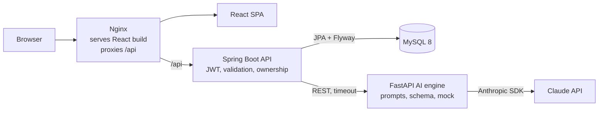
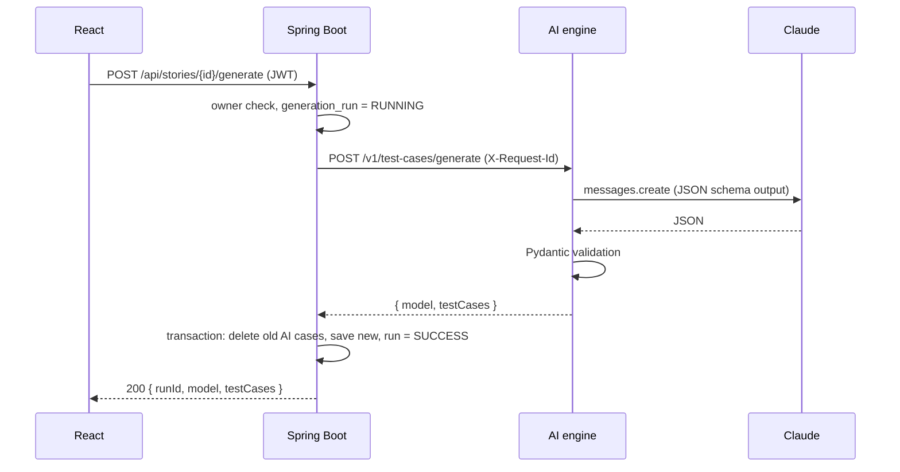
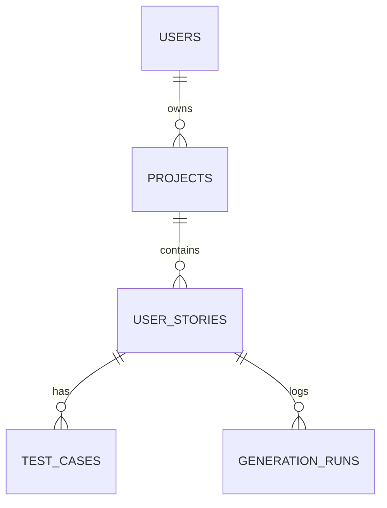

# TestPilot AI — Complete Build Specification (v2)

> **For the AI/developer building this:** this document is the single source of truth. Build
> everything here, in the order of section 18, inside this repository. Where something is not
> specified, choose the simplest standard option and note it in the README. Do not add anything
> listed in "Out of scope".

---

## 0. Context

| Item | Value |
|---|---|
| Repo | `git@github-personal:SheetalK01/testpilot-ai.git` (local: `~/Code/testpilot-ai`) |
| Working branch | `develop`. `main` only gets the final pull request. |
| Owner | Sheetal Khadanga, QA Engineer (Playwright, API, security, accessibility and performance testing; some React/Spring Boot), applying for QA Automation / SDET / Full Stack roles |
| Machine | macOS (Apple Silicon) |
| Installed | Java 17, Maven 3.9, Node 20 / npm 10, Python 3.12 at `/opt/homebrew/bin/python3.12`, Docker (may not be running) |
| Git identity | `Sheetal Khadanga <khadangasheetal@gmail.com>` (already set in repo config) |

**Goal:** a production-quality, eye-catching full-stack project that clearly shows **frontend,
backend, database, AI/LLM, QA automation and DevOps** skills. Recruiters and interviewers will open
this repo, so code quality, tests, UI polish and docs matter as much as features.

---

## 1. Product

**TestPilot AI** turns plain-English user stories into structured test cases and ready-to-run
Playwright scripts.

A QA engineer signs up, creates a **project**, adds **user stories** (title, description,
acceptance criteria) and clicks **Generate**. Claude returns **test cases** (positive, negative,
edge; priority; preconditions; steps; expected result). The user can edit, add, delete and filter
them, **export them to Excel**, and **generate a Playwright script**. A **dashboard** shows charts
and the history of AI runs.

**Tagline:** "Turn user stories into test cases in seconds."

---

## 2. Scope

### In scope (must build)
1. Landing page (public) + register / login / logout (JWT, stateless)
2. Projects CRUD (owner-scoped)
3. User stories CRUD inside a project
4. AI test-case generation (replaces existing **AI** cases, keeps **MANUAL** ones)
5. Test cases: list, filter, add manual, edit, delete
6. AI Playwright script generation (shown with syntax highlighting + copy; not saved)
7. Excel (.xlsx) export
8. Dashboard with charts and recent AI runs
9. Generation run history (every AI call logged)
10. AI engine mock mode + AI quality evaluation script
11. Swagger / OpenAPI docs
12. Tests at every layer (unit, integration, API, E2E, security, accessibility, visual, performance)
13. Docker, docker-compose, GitHub Actions CI
14. Docs: README, API, TEST_PLAN, INTERVIEW_NOTES

### Out of scope (do NOT build)
- Social login, email verification, password reset, refresh tokens
- Teams, sharing, roles beyond "owner"
- Running the generated Playwright script from the UI
- Jira / TestRail integrations, payments, notifications, file uploads
- Kubernetes or cloud deployment automation (README may describe a manual deploy)

---

## 3. Tech stack (use exact versions, commit lock files)

| Layer | Choice |
|---|---|
| Frontend | React 18, Vite, React Router 6, Tailwind CSS v4 (`@tailwindcss/vite`), Recharts, lucide-react, `prism-react-renderer`, Inter font, plain `fetch` wrapper |
| Backend | Java 17, **Spring Boot 4.x** (latest stable), Spring Web MVC, Spring Data JPA, Spring Security + OAuth2 Resource Server (HS256 JWT via Nimbus), Bean Validation, Actuator, springdoc-openapi, Apache POI 5.x |
| Database | MySQL 8.4 (docker-compose); **H2 in-memory, MySQL mode** when `DB_URL` is unset (local dev + tests); **Flyway** migrations |
| AI engine | Python 3.12, FastAPI, Uvicorn, Pydantic v2, official `anthropic` SDK, pytest, Ruff |
| LLM | Claude Opus 5.5, model id **`claude-opus-5-5`** (env `ANTHROPIC_MODEL`) |
| QA | Playwright (JavaScript, Chromium) + `@axe-core/playwright`, k6, JUnit 5 + MockMvc, pytest |
| Code quality | JaCoCo (≥80% line coverage on services), ESLint + Prettier (frontend, e2e), Ruff (AI engine) |
| DevOps | Docker (multi-stage, non-root), docker-compose, Nginx, GitHub Actions |

---

## 4. Architecture



**Principles**
- The frontend never calls the AI engine directly. Every call goes through the backend, which checks
  the JWT and ownership.
- The AI engine is **stateless** and isolated: it only turns a story into JSON. The backend owns all
  data. The API key lives only in the AI engine's environment.
- **Mock mode** makes CI and E2E fast, free and deterministic.
- Every request gets a **request ID** (`X-Request-Id` header, generated if missing) that appears in
  backend logs and is forwarded to the AI engine, so one request can be traced across services.

### Generate flow


---

## 5. Repository layout

```
testpilot-ai/
├── testpilot_backend/
│   ├── src/main/java/com/testpilot/
│   │   ├── TestpilotApplication.java
│   │   ├── config/        SecurityConfig, TestpilotProperties, OpenApiConfig, RequestIdFilter
│   │   ├── auth/          AuthController, AuthService, JwtService, CurrentUser, User, UserRepository, dto/
│   │   ├── project/       Project, ProjectRepository, ProjectService, ProjectController, dto/
│   │   ├── story/         UserStory, UserStoryRepository, StoryService, StoryController, dto/
│   │   ├── testcase/      TestCase, TestCaseType, Priority, Source, TestCaseRepository,
│   │   │                  TestCaseService, TestCaseController, dto/
│   │   ├── generation/    GenerationRun, GenerationKind, GenerationStatus, GenerationRunRepository, GenerationService
│   │   ├── export/        ExcelExportService
│   │   ├── aiengine/      AiEngineClient, AiEngineException, dto/
│   │   ├── dashboard/     DashboardController, DashboardService, dto/
│   │   └── common/        ApiError, GlobalExceptionHandler, NotFoundException, ConflictException
│   ├── src/main/resources/application.yml, db/migration/V1__init.sql
│   ├── src/test/java/com/testpilot/...
│   ├── Dockerfile, pom.xml, mvnw
├── ai_engine/
│   ├── app/  __init__.py, main.py, config.py, schemas.py, prompts.py, llm.py, mock.py, logging.py
│   ├── eval/ stories.json, run_eval.py, results.md (generated)
│   ├── tests/
│   ├── requirements.txt, requirements-dev.txt, pyproject.toml (ruff + pytest config), Dockerfile
├── frontend/
│   ├── src/
│   │   ├── main.jsx, App.jsx, index.css
│   │   ├── services/api.js
│   │   ├── contexts/AuthContext.jsx, ThemeContext.jsx, ToastContext.jsx
│   │   ├── components/  layout/ (AppShell, Navbar, ThemeToggle), ui/ (Button, Card, Badge, Modal,
│   │   │                Input, Textarea, Select, Skeleton, EmptyState, ConfirmDialog, Toast),
│   │   │                charts/ (TypeDonut, PriorityBar), testcases/ (TestCaseTable, TestCaseForm,
│   │   │                GeneratingAnimation), CodeBlock, ProtectedRoute
│   │   └── pages/       LandingPage, LoginPage, RegisterPage, DashboardPage, ProjectPage, StoryPage, NotFoundPage
│   ├── public/ (logo.svg, favicon)
│   ├── index.html, vite.config.js, eslint config, .prettierrc, package.json, Dockerfile, nginx.conf
├── e2e/
│   ├── pages/        Page Objects (LoginPage, RegisterPage, DashboardPage, ProjectPage, StoryPage)
│   ├── fixtures/     test fixtures (authenticated page, api client, test data)
│   ├── helpers/      api.js, data.js
│   ├── tests/ui/     auth, projects, stories-and-generation, dashboard, landing
│   ├── tests/api/    auth, projects, stories, test-cases, security
│   ├── tests/a11y/   accessibility.spec.js
│   ├── tests/visual/ visual.spec.js (+ snapshots)
│   ├── playwright.config.js, package.json, eslint config
├── perf/             smoke.js (k6), README.md
├── docs/             PLAN.md, BUILD_SPEC.md, API.md, TEST_PLAN.md, INTERVIEW_NOTES.md, screenshots/
├── scripts/          dev-local.sh, capture-screenshots.js
├── .github/workflows/ci.yml
├── docker-compose.yml, .env.example, LICENSE (MIT, Sheetal Khadanga), README.md
```

---

## 6. Database

### ER diagram


Created by **Flyway** (`V1__init.sql`), JPA `ddl-auto: validate`. The SQL must work on MySQL 8 and
H2 (MySQL mode). InnoDB, `utf8mb4`.

### `users`
| Column | Type | Rules |
|---|---|---|
| id | BIGINT PK AUTO_INCREMENT | |
| name | VARCHAR(100) | NOT NULL |
| email | VARCHAR(255) | NOT NULL, UNIQUE, stored lower-case |
| password_hash | VARCHAR(100) | NOT NULL, BCrypt |
| created_at | TIMESTAMP | NOT NULL |

### `projects`
| Column | Type | Rules |
|---|---|---|
| id | BIGINT PK | |
| owner_id | BIGINT | NOT NULL, FK → users(id) ON DELETE CASCADE, indexed |
| name | VARCHAR(120) | NOT NULL |
| description | VARCHAR(1000) | NULL |
| created_at, updated_at | TIMESTAMP | NOT NULL |

### `user_stories`
| Column | Type | Rules |
|---|---|---|
| id | BIGINT PK | |
| project_id | BIGINT | NOT NULL, FK → projects(id) ON DELETE CASCADE, indexed |
| title | VARCHAR(200) | NOT NULL |
| description | TEXT | NOT NULL |
| acceptance_criteria | TEXT | NULL |
| created_at, updated_at | TIMESTAMP | NOT NULL |

### `test_cases`
| Column | Type | Rules |
|---|---|---|
| id | BIGINT PK | |
| story_id | BIGINT | NOT NULL, FK → user_stories(id) ON DELETE CASCADE, indexed |
| title | VARCHAR(255) | NOT NULL |
| type | VARCHAR(20) | `POSITIVE` / `NEGATIVE` / `EDGE` |
| priority | VARCHAR(10) | `HIGH` / `MEDIUM` / `LOW` |
| preconditions | TEXT | NULL |
| steps | TEXT | NOT NULL, one step per line (API exposes `string[]`) |
| expected_result | TEXT | NOT NULL |
| source | VARCHAR(10) | `AI` / `MANUAL` |
| created_at, updated_at | TIMESTAMP | NOT NULL |

### `generation_runs`
| Column | Type | Rules |
|---|---|---|
| id | BIGINT PK | |
| story_id | BIGINT | NOT NULL, FK → user_stories(id) ON DELETE CASCADE, indexed |
| kind | VARCHAR(20) | `TEST_CASES` / `PLAYWRIGHT` |
| status | VARCHAR(10) | `RUNNING` / `SUCCESS` / `FAILED` |
| model | VARCHAR(60) | NULL (`mock` in mock mode) |
| test_case_count | INT | NULL |
| duration_ms | INT | NULL |
| error_message | VARCHAR(500) | NULL |
| created_at | TIMESTAMP | NOT NULL, indexed (dashboard sorts by it) |

**Ownership:** every read/write checks the resource belongs to the logged-in user. Another user's
resource returns **404** (not 403), so IDs are not leaked.

---

## 7. Backend

### 7.1 Design
- Controller (HTTP only) → Service (logic, `@Transactional`) → Repository. DTOs are Java `record`s;
  entities are never returned.
- `CurrentUser` helper reads the user id from the JWT (`sub`).
- Bean Validation on every request body; `GlobalExceptionHandler` maps everything to one error
  format; no stack traces leak.
- `RequestIdFilter` puts the request ID into the logging MDC and the response header. Log pattern
  includes it. Log one line per request (method, path, status, duration).
- Swagger UI at `/swagger-ui.html` (public), with JWT "Authorize" button; every endpoint has a
  summary and response codes.
- CORS from `CORS_ALLOWED_ORIGINS`.

### 7.2 Error format
```json
{ "status": 400, "message": "Validation failed", "errors": { "email": "must be a well-formed email address" }, "path": "/api/auth/register", "requestId": "c0a8...", "timestamp": "2026-10-23T10:00:00Z" }
```
400 validation · 401 missing/invalid/expired token or bad credentials · 404 not found or not owned ·
409 duplicate email · 502 AI engine failure.

### 7.3 Endpoints
Base `/api`, JSON camelCase. All need `Authorization: Bearer <jwt>` except register, login,
`/actuator/health`, Swagger.

**Auth**
| Method | Path | Body | Response |
|---|---|---|---|
| POST | `/auth/register` | `{ name 2-100, email, password 8-72 with ≥1 letter and ≥1 digit }` | 201 `{ token, user: { id, name, email } }`; 409 duplicate |
| POST | `/auth/login` | `{ email, password }` | 200 `{ token, user }`; 401 "Invalid email or password" |
| GET | `/auth/me` | — | 200 user |

JWT HS256, `sub` = user id, claims `email`, `name`, expiry `JWT_TTL_MINUTES` (default 720).

**Projects**
| Method | Path | Body | Response |
|---|---|---|---|
| GET | `/projects` | — | `[{ id, name, description, storyCount, testCaseCount, createdAt, updatedAt }]`, newest first |
| POST | `/projects` | `{ name 1-120, description ≤1000? }` | 201 |
| GET/PUT/DELETE | `/projects/{id}` | PUT same as POST | 200 / 200 / 204 |

**Stories**
| Method | Path | Body | Response |
|---|---|---|---|
| GET | `/projects/{projectId}/stories` | — | `[{ id, projectId, title, description, acceptanceCriteria, testCaseCount, createdAt, updatedAt }]` |
| POST | `/projects/{projectId}/stories` | `{ title 1-200, description 1-5000, acceptanceCriteria ≤5000? }` | 201 |
| GET/PUT/DELETE | `/stories/{id}` | PUT same as POST | 200 / 200 / 204 |

**Test cases** — JSON:
```json
{ "id": 1, "storyId": 3, "title": "Login with valid credentials", "type": "POSITIVE", "priority": "HIGH",
  "preconditions": "User account exists", "steps": ["Open /login", "Enter valid email and password", "Click Log in"],
  "expectedResult": "User lands on the dashboard", "source": "AI", "createdAt": "...", "updatedAt": "..." }
```
| Method | Path | Body | Response |
|---|---|---|---|
| GET | `/stories/{id}/test-cases` | — | ordered HIGH→LOW, then id |
| POST | `/stories/{id}/test-cases` | `{ title 1-255, type, priority, preconditions?, steps 1-30 items each 1-500, expectedResult 1-2000 }` | 201, `source=MANUAL` |
| PUT | `/test-cases/{id}` | same | 200 (source unchanged) |
| DELETE | `/test-cases/{id}` | — | 204 |
| POST | `/stories/{id}/generate` | — | 200 `{ runId, model, testCases }` |
| POST | `/stories/{id}/playwright` | `{ baseUrl? }` default `http://localhost:3000` | 200 `{ runId, model, script }`; 400 if no test cases |
| GET | `/stories/{id}/export` | — | `.xlsx`, `Content-Disposition: attachment; filename="<slug>-test-cases.xlsx"` |

**Dashboard** — `GET /dashboard`:
```json
{ "projectCount": 2, "storyCount": 5, "testCaseCount": 41,
  "byType": { "POSITIVE": 15, "NEGATIVE": 18, "EDGE": 8 },
  "byPriority": { "HIGH": 12, "MEDIUM": 20, "LOW": 9 },
  "recentRuns": [ { "id": 9, "storyId": 3, "storyTitle": "Login", "kind": "TEST_CASES", "status": "SUCCESS",
                    "model": "claude-opus-5-5", "testCaseCount": 9, "durationMs": 8123, "createdAt": "..." } ] }
```
All enum keys always present (0 when empty). `recentRuns` = last 10.

### 7.4 Generation logic
1. Owner check → insert run `RUNNING`.
2. Call AI engine (timeout `AI_ENGINE_TIMEOUT_SECONDS`, default 120), forwarding `X-Request-Id`.
3. Success → one transaction: delete story's `AI` cases, insert new, run `SUCCESS` (count, duration, model).
4. Failure (timeout, non-2xx, bad body) → run `FAILED` with a short message (≤500 chars), respond
   **502** "AI engine failed: <reason>". Existing cases untouched.

### 7.5 Excel export
Sheet "Test Cases": row 1 story title (bold, larger); header row `#`, `Title`, `Type`, `Priority`,
`Preconditions`, `Steps`, `Expected Result`, `Source` (bold, coloured fill, white text); steps
numbered with line breaks; wrapped text; frozen header; auto filter; sensible widths; type cells
lightly colour-coded.

### 7.6 Config (env overridable)
`PORT=8080`, `DB_URL` (default H2), `DB_USERNAME`, `DB_PASSWORD`, `JWT_SECRET` (≥32 bytes; dev
default), `JWT_TTL_MINUTES=720`, `AI_ENGINE_URL=http://localhost:8000`,
`AI_ENGINE_TIMEOUT_SECONDS=120`, `CORS_ALLOWED_ORIGINS=http://localhost:5173,http://localhost:4173,http://localhost:3000`.

---

## 8. AI engine

### 8.1 Endpoints
| Method | Path | Request | Response |
|---|---|---|---|
| GET | `/health` | — | `{ status: "ok", mode: "live"|"mock", model }` |
| POST | `/v1/test-cases/generate` | `{ title, description, acceptanceCriteria? }` | `{ model, testCases: [{ title, type, priority, preconditions, steps[], expectedResult }] }` |
| POST | `/v1/playwright/generate` | `{ story: {...}, testCases: [...] (≤50), baseUrl }` | `{ model, script }` |

camelCase JSON (`alias_generator=to_camel`, `populate_by_name=True`). 422 on bad input, **502**
`{ detail }` on LLM failure/refusal. Swagger at `/docs`. Structured JSON logs with request ID.

### 8.2 Settings
`AI_MODE` (`live`|`mock`; `live` without `ANTHROPIC_API_KEY` → falls back to mock with a warning),
`ANTHROPIC_API_KEY`, `ANTHROPIC_MODEL=claude-opus-5-5`, `LLM_TIMEOUT_SECONDS=90`.

### 8.3 Live mode
- Official `anthropic` SDK only (no raw HTTP, no OpenAI shims). Check the current SDK docs for
  exact parameter names before writing the code.
- Test cases: `client.messages.create(...)` with structured output
  `output_config={"format": {"type": "json_schema", "schema": SCHEMA}}`; parse the text block with
  `json.loads`; validate with Pydantic. Schema: `additionalProperties: false`, all fields required,
  enums for `type`/`priority`, `steps` array of strings, 3–15 test cases.
- Check `stop_reason`: `refusal` → 502 "Model declined the request"; `max_tokens` → 502 "Response
  was cut off".
- `max_tokens` 16000. Do **not** send `temperature`/`top_p`/`top_k`, `thinking: {type: "disabled"}`
  or `budget_tokens` (rejected by the current API/model).
- Map typed SDK errors (`APITimeoutError`, `RateLimitError`, `APIStatusError`,
  `APIConnectionError`) to clear 502 messages.
- Playwright: second call, plain text; strip markdown fences.

### 8.4 Prompts (`prompts.py`, with a comment block explaining the design)
- **Test cases (system):** senior QA engineer; clear, independent, executable test cases; cover happy
  path, validation and error handling, boundaries and edge cases implied by the acceptance criteria;
  one purpose per case; short imperative steps; observable, specific expected results; never invent
  features the story doesn't mention; definitions of each type and priority.
- **User:** story title, description, acceptance criteria inside clear XML-style tags.
- **Playwright (system):** one JS test file with `@playwright/test`; one `test()` per case inside a
  `test.describe()` named after the story; role/label locators (`getByRole`, `getByLabel`), no CSS;
  `baseURL` paths; `// TODO` where a selector or data cannot be known; output only code.

### 8.5 Mock mode
- Exactly **6** deterministic cases using the story title: 2 POSITIVE (HIGH, MEDIUM), 3 NEGATIVE
  (HIGH, MEDIUM, LOW), 1 EDGE (MEDIUM); titles like `"<title>: happy path with valid data"`;
  `model: "mock"`; small artificial delay (≈800 ms) so the UI animation is visible.
- Playwright mock: deterministic template, one `test()` per case.

### 8.6 AI quality evaluation (`eval/`)
- `stories.json`: 5 stories (login, signup, password reset, cart checkout, file upload) with
  acceptance criteria.
- `run_eval.py` (live mode): generates cases per story and scores: schema valid, all three types
  present, no empty steps, no duplicate titles, acceptance-criteria keyword coverage (%), latency.
  Prints a table and writes `eval/results.md`. Documented in README as "AI quality evaluation".
- In mock mode the script still runs (to prove it works) and says results are from mock.

---

## 9. Frontend

### 9.1 Design system
- **Brand:** name "TestPilot AI", simple SVG logo (paper-plane + check mark), indigo→violet accent
  gradient used sparingly (logo, primary buttons, hero).
- **Typography:** Inter; clear scale (display, h1–h3, body, small).
- **Surfaces:** rounded-2xl cards, soft shadows, 1px subtle borders, generous spacing (8px grid).
- **Colour tokens** in CSS variables for light and **dark mode**; toggle in navbar; remembers choice;
  respects `prefers-color-scheme` on first visit.
- **Badges:** POSITIVE green, NEGATIVE red, EDGE amber; HIGH/MEDIUM/LOW with distinct tones.
- **Icons:** lucide-react.
- **Motion:** subtle (150–250 ms) hover/focus transitions; respects `prefers-reduced-motion`.
- **Accessibility:** WCAG 2.1 AA contrast, visible focus rings, labels on all inputs, keyboard
  navigable modals (focus trap, Esc to close), semantic landmarks.
- **Responsive:** 375px mobile to wide desktop; tables become cards on small screens.

### 9.2 Pages
| Route | Page | Content |
|---|---|---|
| `/` (logged out) | **Landing** | Hero (tagline, sub-text, "Get started free" + "See how it works"), an **animated demo** of a story card turning into test case cards, a 4-feature grid (AI generation, Playwright export, Excel export, Dashboard), a "How it works" 3-step section, tech stack strip, footer with GitHub + LinkedIn links |
| `/` (logged in) | **Dashboard** | Greeting, 3 stat cards (projects, stories, test cases), **donut chart** by type, **bar chart** by priority (Recharts), recent AI runs table (status pill, model, duration), project cards grid, "New project" modal, empty state with illustration |
| `/login`, `/register` | Auth | Split layout (form + brand panel), inline validation, show/hide password, error banner |
| `/projects/:id` | Project | Header with edit/delete, stories list with test case counts, "Add story" modal |
| `/stories/:id` | Story | Story card (edit/delete), **Generate** button → **"AI is generating…" animation** (shimmer + cases appearing one by one), test case table (type/priority badges, expandable steps, edit modal, delete confirm, add manual), type filter chips, **Export Excel**, **Generate Playwright** → code panel with Prism highlighting and copy button, error banner for AI failures |
| `*` | 404 | Friendly not-found page |

### 9.3 Behaviour
- JWT in `localStorage` (`tp_token`); on any 401 clear it and go to `/login`.
- `VITE_API_URL` (default same origin); Vite dev server proxies `/api` → `http://localhost:8080`.
- Skeleton loaders while loading; toasts for success/error; optimistic UI where safe.
- No console errors or warnings; ESLint + Prettier clean.

### 9.4 Required `data-testid`s
`login-email`, `login-password`, `login-submit`, `register-name`, `register-email`,
`register-password`, `register-submit`, `auth-error`, `nav-logout`, `nav-user`, `theme-toggle`,
`landing-cta`, `stat-projects`, `stat-stories`, `stat-test-cases`, `chart-type`, `chart-priority`,
`recent-runs`, `new-project-button`, `project-name-input`, `project-description-input`,
`project-save`, `project-card`, `project-title`, `project-edit`, `project-delete`, `confirm-delete`,
`add-story-button`, `story-title-input`, `story-description-input`, `story-criteria-input`,
`story-save`, `story-row`, `story-title`, `story-edit`, `story-delete`, `generate-button`,
`generating-indicator`, `generation-error`, `test-case-row`, `test-case-title`, `test-case-type`,
`test-case-priority`, `test-case-edit`, `test-case-delete`, `add-test-case-button`,
`tc-title-input`, `tc-type-select`, `tc-priority-select`, `tc-preconditions-input`,
`tc-steps-input` (one step per line), `tc-expected-input`, `tc-save`, `type-filter-<TYPE|ALL>`,
`export-button`, `playwright-button`, `playwright-script`, `copy-script`, `toast`.

---

## 10. QA automation (the owner's core skill — make it shine)

### 10.1 Framework
- Playwright (JS) with **Page Object Model** (`e2e/pages`), **custom fixtures** (logged-in page,
  API client, unique test data), API helpers for fast setup, **tags** `@smoke`, `@regression`,
  `@api`, `@security`, `@a11y`, `@visual`.
- Config: projects for `ui`, `api`, `a11y`, `visual`; retries 1 on CI; trace, screenshot and video
  on failure; HTML report; `webServer` starts backend + AI engine (mock) + frontend.
- Each test creates its own user (unique email) → tests are independent and parallel-safe.

### 10.2 Suites (minimum)
| Suite | Cases |
|---|---|
| UI · auth | register → dashboard; logout; login; wrong password error; protected route redirects; landing CTA goes to register |
| UI · projects | create → card visible → open → edit → delete with confirm; validation message on empty name |
| UI · stories & generation | add story → generate → 6 rows with badges → filter NEGATIVE = 3 → edit a case → add manual → regenerate keeps manual → export downloads `.xlsx` → Playwright panel shows code → copy works |
| UI · dashboard | stats and charts reflect created data; recent run listed |
| API · contracts | status codes and response shapes for every endpoint; error format |
| API · validation | boundary values (lengths, empty steps, bad enums) → 400 with field errors |
| **Security** | user B cannot read/update/delete user A's project, story or test case (**IDOR → 404**); no token / tampered token / expired token → 401; SQL and `<script>` payloads stored and rendered safely (escaped); password never returned |
| **Accessibility** | `@axe-core/playwright` on landing, login, register, dashboard, project, story (light + dark): zero serious/critical violations |
| **Visual** | screenshot snapshots of landing, dashboard, story (masked dynamic data) |
| **Performance** | `perf/smoke.js` (k6): login + list projects + get dashboard, 10 VUs × 30 s, thresholds p95 < 500 ms, errors < 1% |

### 10.3 Lower layers
- **Backend (JUnit 5 + MockMvc + H2, AI client mocked with `@MockitoBean`):** auth (register,
  duplicate, invalid, login, wrong password, /me with/without token), projects CRUD + IDOR + counts,
  stories CRUD + IDOR + cascade, test cases CRUD + ordering + validation, generate success (replaces
  AI, keeps MANUAL, SUCCESS run) and failure (502, FAILED run, data untouched), playwright (400 with no
  cases, success), export (content type; read workbook back with POI and check rows), dashboard
  counts. Plus unit tests for services and `JwtService`. JaCoCo ≥80% on services.
- **AI engine (pytest):** health/mode, mock shape and enums, input validation (422), prompt builder,
  live path with the Anthropic client **mocked** (valid JSON → 200, refusal → 502, invalid JSON →
  502, timeout → 502), fence stripper, eval scorer functions.

### 10.4 `docs/TEST_PLAN.md`
Written like a QA lead: objective, scope / out of scope, test pyramid and strategy, environments,
entry/exit criteria, risks and mitigations, test case table (ID, title, suite, type, priority,
automated, spec file), how to run each suite, and reporting.

---

## 11. DevOps

- **Dockerfiles:** backend (Maven build → `eclipse-temurin:17-jre`, non-root), AI engine
  (`python:3.12-slim`, non-root), frontend (Node build → `nginx:alpine`; SPA fallback; `/api` proxy to
  `backend:8080`). Healthchecks.
- **docker-compose.yml:** `mysql` (8.4, healthcheck, volume), `ai-engine`, `backend` (waits for
  healthy MySQL), `frontend` on **http://localhost:3000**. Reads `.env`.
- **.env.example:** every variable with safe placeholders, `AI_MODE=mock`.
- **scripts/dev-local.sh:** runs backend (H2) + AI engine + Vite together without Docker; Ctrl+C
  stops all.
- **CI (`.github/workflows/ci.yml`):** on push to `main`/`develop`/`feature/**` and PRs.
  Jobs: `lint` (ESLint, Prettier check, Ruff) → `backend` (`./mvnw -B verify`, upload JaCoCo report)
  → `ai-engine` (pytest) → `frontend` (build) → `e2e` (all Playwright projects against mock AI,
  upload HTML report always) → `perf` (k6 smoke against the running stack). Caches for Maven, pip,
  npm. Badges in README.

---

## 12. Documentation

- **README.md** (sells the project): logo banner, badges (CI, coverage, license, tech), one-line
  pitch, demo GIF + screenshots (captured by `scripts/capture-screenshots.js` with Playwright into
  `docs/screenshots/`, light and dark), "Why I built this" (QA engineer who writes test cases daily),
  features, architecture (mermaid), tech stack, quick start (Docker / without Docker), environment
  variables, running every test suite, AI quality evaluation, project structure, API overview (link
  to Swagger + `docs/API.md`), roadmap, author section with LinkedIn
  `https://www.linkedin.com/in/sheetal-khadanga` and GitHub `https://github.com/SheetalK01`.
- **docs/API.md:** every endpoint with request/response examples and error codes.
- **docs/TEST_PLAN.md:** see 10.4.
- **docs/INTERVIEW_NOTES.md:** per layer, the key design decisions and *why* (JWT vs sessions, HS256,
  separate AI engine, mock mode, structured output, ownership → 404, Flyway, DTOs, transactions,
  request IDs, POM + fixtures, test pyramid, CI stages), trade-offs and what would change at scale,
  plus **20 likely interview questions with short answers** based on this codebase.
- Keep `docs/PLAN.md` consistent (or reduce it to an overview pointing here).

---

## 13. Security checklist
- BCrypt passwords; password never returned or logged.
- JWT signature + expiry validated; secret only from env.
- Owner check on every resource; 404 for others.
- Validation and length limits everywhere; JPA parameter binding (no string SQL).
- React escapes output; never `dangerouslySetInnerHTML` with user data.
- CORS allow-list; security headers via Nginx (`X-Content-Type-Options`, `X-Frame-Options`,
  `Referrer-Policy`, basic CSP).
- No secrets in git; `.env` ignored.

---

## 14. Quality bar
- Clean, consistent, readable code; small functions; meaningful names; comments only where the *why*
  isn't obvious.
- Loading, empty and error states on every screen.
- Everything runs from a fresh clone by following the README.
- Lint clean, all tests green, coverage target met.

---

## 15. Skills showcase map (for README and interviews)

| Skill | Where it shows |
|---|---|
| React / UI/UX | Landing page, design system, dark mode, charts, animations, responsive + accessible |
| Java / Spring Boot | Layered API, Security + JWT, validation, error handling, Swagger, logging |
| Database | Schema design, Flyway migrations, indexes, cascades, ownership queries |
| AI / LLM | Prompt design, structured output, error/refusal handling, mock mode, quality evaluation |
| Python | FastAPI service, Pydantic, pytest, eval script |
| QA Automation | Playwright POM + fixtures, UI/API/security/a11y/visual/perf suites, test plan |
| DevOps | Docker, compose, Nginx, GitHub Actions pipeline, badges, artifacts |

---

## 16. Environment variables

| Variable | Used by | Default / example |
|---|---|---|
| `DB_URL`, `DB_USERNAME`, `DB_PASSWORD` | backend | H2 / `jdbc:mysql://mysql:3306/testpilot` |
| `JWT_SECRET`, `JWT_TTL_MINUTES` | backend | dev secret / 720 |
| `AI_ENGINE_URL`, `AI_ENGINE_TIMEOUT_SECONDS` | backend | `http://localhost:8000` / 120 |
| `CORS_ALLOWED_ORIGINS` | backend | localhost 5173, 4173, 3000 |
| `AI_MODE`, `ANTHROPIC_API_KEY`, `ANTHROPIC_MODEL`, `LLM_TIMEOUT_SECONDS` | ai_engine | `mock` / — / `claude-opus-5-5` / 90 |
| `VITE_API_URL` | frontend | empty (same origin) |
| `MYSQL_ROOT_PASSWORD`, `MYSQL_DATABASE`, `MYSQL_USER`, `MYSQL_PASSWORD` | compose | placeholders |

---

## 17. Secrets rule
All tests and CI use mock AI. The owner adds the real `ANTHROPIC_API_KEY` to `.env` herself. Never
ask for the key in chat; never commit secrets.

---

## 18. Build order

Work on `develop`; commit and push after each phase with clear messages.

| Phase | Work | Done when |
|---|---|---|
| 1 | Backend: skeleton, config, Flyway V1, entities, auth + JWT, projects, stories, test cases CRUD, errors, request IDs, Swagger, tests | `./mvnw verify` green, coverage report generated |
| 2 | AI engine: schemas, prompts, mock, live client, routes, logging, pytest, Ruff, eval script | `pytest` + `ruff check` green; mock curl works |
| 3 | Backend ↔ AI: client, generate, playwright, runs, Excel export, dashboard + tests | `./mvnw verify` green, ≥80% service coverage |
| 4 | Frontend: design system, landing, auth, dashboard (charts), project, story (animation, code panel), dark mode, all data-testids | `npm run lint` + `npm run build` green; smoke via `scripts/dev-local.sh` |
| 5 | QA: Playwright framework (POM, fixtures, tags), UI/API/security/a11y/visual suites, k6 smoke, TEST_PLAN.md | `npx playwright test` green locally |
| 6 | DevOps: Dockerfiles, compose, Nginx headers, `.env.example`, CI workflow | CI green on GitHub; `docker compose up` works if Docker is running |
| 7 | Docs & polish: screenshots/GIF, README, API.md, INTERVIEW_NOTES.md, final UI polish | fresh-clone run verified |

Finish by opening a pull request **develop → main** titled "TestPilot AI v1.0" with a summary (what
was built, how it was tested). Do **not** merge it.

---

## 19. Definition of done
- [ ] All CI jobs green on GitHub
- [ ] `./mvnw verify`, `pytest`, `ruff check`, `npm run lint`, `npm run build`, `npx playwright test` pass locally
- [ ] Coverage ≥80% on backend services
- [ ] Zero serious/critical axe violations
- [ ] App works end to end via `scripts/dev-local.sh` (mock) and `docker compose up`
- [ ] With a real key and `AI_MODE=live`, generation returns sensible schema-valid cases; eval results committed
- [ ] README lets a stranger run it in under 10 minutes; screenshots in light and dark mode
- [ ] No secrets committed; no TODOs in app code (TODOs inside *generated* scripts are expected)
