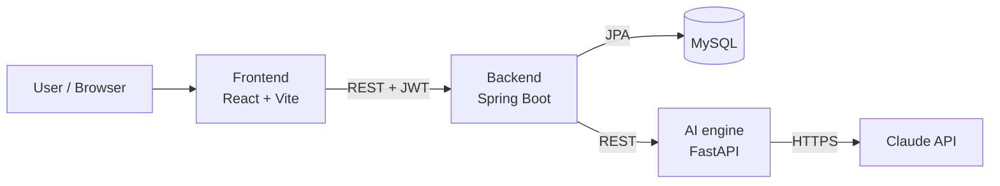
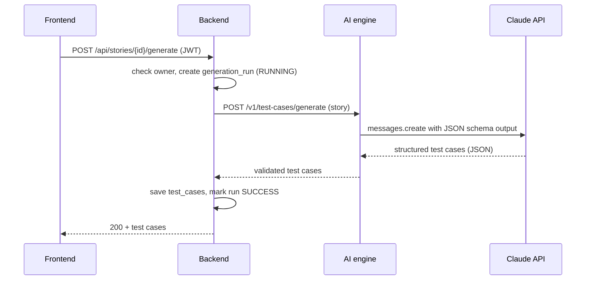
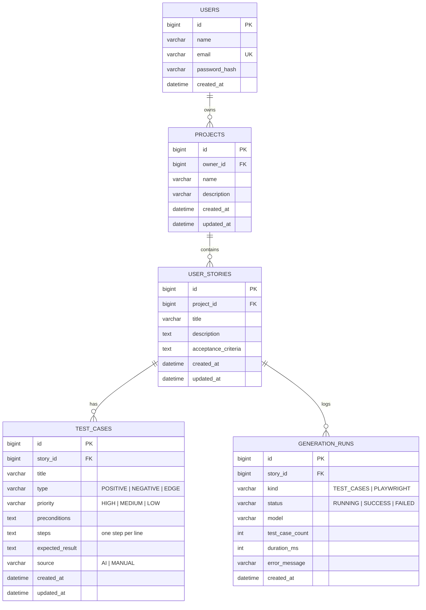

# TestPilot AI — Project Plan

AI-powered test case generator. A QA engineer pastes a user story, the AI writes structured test
cases (positive, negative, edge), and one click turns them into a runnable Playwright script or an
Excel test suite.

---

## 1. Features (MVP)

| # | Feature | Area |
|---|---|---|
| 1 | Sign up / log in with JWT | Backend + Frontend |
| 2 | Projects: create, list, edit, delete | Backend + Frontend |
| 3 | User stories per project (title, description, acceptance criteria) | Backend + Frontend |
| 4 | **Generate test cases with AI** (positive / negative / edge, priority, steps, expected result) | AI engine |
| 5 | Review, edit, add and delete test cases | Frontend |
| 6 | **Generate Playwright script** from the test cases | AI engine |
| 7 | **Export test suite to Excel** | Backend |
| 8 | Dashboard: counts by type and priority, recent AI runs | Backend + Frontend |
| 9 | Automated tests + CI on every push | QA |

**Later (v2):** share project with teammates, test run tracking (pass/fail), Jira import, run the
generated Playwright script from the UI.

---

## 2. Tech stack

| Layer | Technology | Why |
|---|---|---|
| Frontend | **React 18 + Vite**, React Router, Tailwind CSS | Fast dev server, industry standard |
| Backend | **Java 17 + Spring Boot 4**, Spring Data JPA, Spring Security (JWT) | Enterprise-grade REST API |
| AI engine | **Python 3.12 + FastAPI**, Anthropic SDK (Claude API), Pydantic | Python is the AI ecosystem; isolates LLM logic |
| Database | **MySQL 8** (H2 in-memory for local dev and tests) | Relational data with clear ownership |
| Excel | Apache POI | Export test suites |
| Testing | JUnit 5 + MockMvc, Pytest, **Playwright** (E2E + API) | Every layer tested |
| DevOps | Docker + docker-compose, **GitHub Actions CI**, Nginx | One-command setup, tests on every push |

---

## 3. Architecture



- The **frontend never talks to the AI engine directly**. Every request goes through the backend,
  which checks the JWT and that the user owns the project.
- The **AI engine is stateless**: it gets a story, returns test cases. The backend saves them.
- The AI engine has a **mock mode** (`AI_MODE=mock`) that returns fixed test cases without calling
  Claude. CI and E2E tests use it, so they are fast, free and deterministic.

### Generate flow



---

## 4. Repository structure

Monorepo, same layout style as a production product repo.

```
testpilot-ai/
├── testpilot_backend/        # Spring Boot REST API
│   ├── src/main/java/com/testpilot/
│   │   ├── auth/             # register, login, JWT, users
│   │   ├── project/          # projects CRUD
│   │   ├── story/            # user stories CRUD
│   │   ├── testcase/         # test cases CRUD, generate, Excel export
│   │   ├── aiengine/         # HTTP client for the AI engine
│   │   ├── dashboard/        # stats
│   │   ├── common/           # errors, exception handler
│   │   └── config/           # security, CORS, properties
│   ├── src/test/java/...     # JUnit + MockMvc tests
│   ├── Dockerfile
│   └── pom.xml
├── ai_engine/                # FastAPI + Claude API
│   ├── app/
│   │   ├── main.py           # routes
│   │   ├── schemas.py        # Pydantic models
│   │   ├── prompts.py        # prompt templates
│   │   ├── llm.py            # Claude client
│   │   └── mock.py           # mock mode
│   ├── tests/                # pytest
│   ├── Dockerfile
│   └── requirements.txt
├── frontend/                 # React + Vite
│   ├── src/
│   │   ├── pages/            # Login, Register, Dashboard, Project, Story
│   │   ├── components/       # reusable UI
│   │   ├── services/         # API client
│   │   └── contexts/         # auth context
│   ├── Dockerfile
│   └── package.json
├── e2e/                      # Playwright E2E + API tests
│   ├── tests/ui/
│   ├── tests/api/
│   └── playwright.config.js
├── docs/                     # PLAN, architecture, API, test plan
├── nginx/                    # reverse proxy config
├── scripts/                  # dev-local.sh, seed data
├── .github/workflows/        # CI pipeline
├── docker-compose.yml
├── .env.example
└── README.md
```

---

## 5. Database schema



**Rules**
- A user only sees their own projects. Every query filters by `owner_id`.
- Deleting a project deletes its stories, test cases and runs (cascade).
- `email` is unique. Passwords are stored as **BCrypt** hashes only.
- `generation_runs` keeps a history of every AI call (model, duration, success or failure). This
  feeds the dashboard and helps with debugging.

---

## 6. REST API (backend)

All routes except register/login need `Authorization: Bearer <token>`.

| Method | Endpoint | Description |
|---|---|---|
| POST | `/api/auth/register` | Create account → `{ token, user }` |
| POST | `/api/auth/login` | Log in → `{ token, user }` |
| GET | `/api/auth/me` | Current user |
| GET | `/api/projects` | My projects (with story and test case counts) |
| POST | `/api/projects` | Create project |
| GET / PUT / DELETE | `/api/projects/{id}` | Read / update / delete project |
| GET | `/api/projects/{id}/stories` | Stories in a project |
| POST | `/api/projects/{id}/stories` | Add story |
| GET / PUT / DELETE | `/api/stories/{id}` | Read / update / delete story |
| POST | `/api/stories/{id}/generate` | **AI: generate test cases** |
| GET | `/api/stories/{id}/test-cases` | List test cases |
| POST | `/api/stories/{id}/test-cases` | Add a manual test case |
| PUT / DELETE | `/api/test-cases/{id}` | Edit / delete test case |
| POST | `/api/stories/{id}/playwright` | **AI: generate Playwright script** |
| GET | `/api/stories/{id}/export` | **Download Excel** |
| GET | `/api/dashboard` | Stats for the dashboard |

**Error format** (same everywhere):
```json
{ "status": 400, "message": "Validation failed", "errors": { "title": "must not be blank" } }
```

---

## 7. AI engine

| Method | Endpoint | Input → Output |
|---|---|---|
| POST | `/v1/test-cases/generate` | story → `{ testCases: [...] }` |
| POST | `/v1/playwright/generate` | story + test cases → `{ script }` |
| GET | `/health` | status + mode (`live` / `mock`) |

- **Model:** Claude Opus 5.5 (`claude-opus-5-5`) through the official Anthropic Python SDK.
- **Structured output:** the request includes a JSON schema, so Claude always returns valid JSON in
  the shape we expect. Pydantic validates it again before it goes back to the backend.
- **Prompt:** a system prompt that acts as a senior QA engineer, plus the story and acceptance
  criteria. It asks for coverage of the happy path, validation errors, boundaries and edge cases,
  with 5–12 cases.
- **Safety and errors:** handles refusals, timeouts and API errors, and returns a clean `502` to the
  backend, which marks the run `FAILED`.
- **Mock mode:** `AI_MODE=mock` returns fixed test cases. It is used in CI, in E2E tests, and when
  no API key is set.
- The API key lives only in the AI engine's environment (`ANTHROPIC_API_KEY`), never in the
  frontend or the database.

---

## 8. Frontend pages

| Page | What it shows |
|---|---|
| `/login`, `/register` | Auth forms with validation |
| `/` Dashboard | Project cards, total counts, test cases by type and priority |
| `/projects/:id` | Project details, list of stories, "Add story" form |
| `/stories/:id` | Story details, **Generate** button, test case table (edit inline, delete, add), **Playwright script** viewer with copy button, **Export Excel** button |

Every interactive element gets a `data-testid` so the Playwright tests are stable.

---

## 9. Testing strategy (the QA part)

| Level | Tool | What it covers |
|---|---|---|
| Unit | JUnit 5, Pytest | Services, prompt building, schema validation, Excel export |
| Integration | Spring Boot Test + MockMvc (H2) | Every endpoint: auth, ownership (user A cannot see user B's data), validation errors |
| API | Playwright `request` | Contract checks against the running backend |
| E2E | Playwright (Chromium) | Register → create project → add story → generate → edit → export → logout |
| Edge cases | Playwright + Pytest | Empty or very long stories, AI failure, expired token, duplicate email |

- `docs/TEST_PLAN.md` will list the test cases (written TestPilot style 🙂).
- E2E runs against the **mock AI**, so results never depend on the LLM.

---

## 10. CI/CD (GitHub Actions)

On every push and pull request:

1. **Backend:** `mvn verify` (JUnit + MockMvc)
2. **AI engine:** `pytest`
3. **Frontend:** `npm ci && npm run build`
4. **E2E:** start backend (H2) + AI engine (mock) + frontend, run Playwright, upload the HTML report
   as an artifact

A green badge goes in the README.

---

## 11. Git workflow

- `main`: stable, demo-ready code only
- `develop`: integration branch, all work merges here first
- `feature/<name>`: one branch per phase (for example `feature/backend-auth`), merged into `develop`
  through a pull request
- When a phase is complete and green, `develop` is merged into `main`

---

## 12. Phases

| Phase | Branch | Deliverable |
|---|---|---|
| 0 | `develop` | Plan, repo structure, README, docker-compose skeleton ✅ *(this doc)* |
| 1 | `feature/backend-core` | Spring Boot: entities, auth (JWT), projects, stories, test cases CRUD + tests |
| 2 | `feature/ai-engine` | FastAPI + Claude: generate test cases and Playwright scripts, mock mode + pytest |
| 3 | `feature/backend-ai` | Backend ↔ AI engine integration, generation runs, Excel export |
| 4 | `feature/frontend` | React UI: auth, dashboard, project, story pages |
| 5 | `feature/e2e-tests` | Playwright E2E + API tests, TEST_PLAN.md |
| 6 | `feature/ci-docker` | GitHub Actions, Dockerfiles, docker-compose, Nginx |
| 7 | `release/v1.0` | README with screenshots and demo GIF, deploy, merge to `main`, LinkedIn post |

---

## 13. Environment variables

| Variable | Used by | Example |
|---|---|---|
| `DB_URL`, `DB_USERNAME`, `DB_PASSWORD` | backend | `jdbc:mysql://mysql:3306/testpilot` |
| `JWT_SECRET` | backend | 32+ random characters |
| `AI_ENGINE_URL` | backend | `http://ai-engine:8000` |
| `CORS_ALLOWED_ORIGINS` | backend | `http://localhost:5173` |
| `ANTHROPIC_API_KEY` | ai_engine | from console.anthropic.com |
| `AI_MODE` | ai_engine | `live` or `mock` |
| `VITE_API_URL` | frontend | `http://localhost:8080` |
